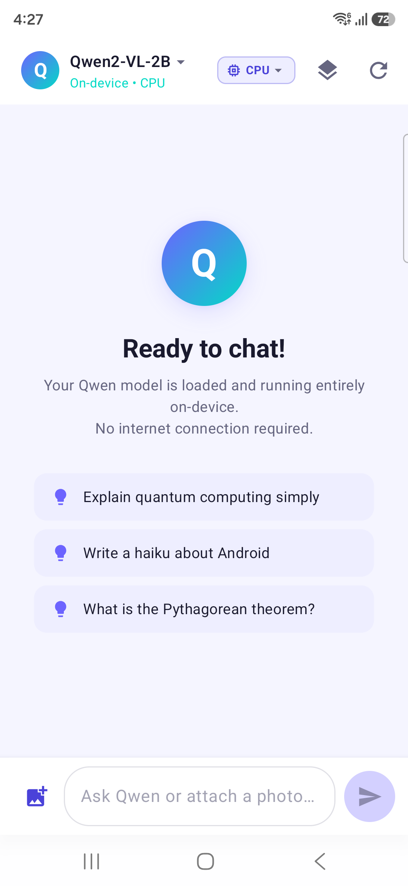
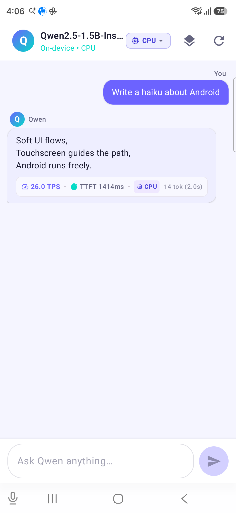

# On-Device Qwen: Offline LLM & VLM for Android 🚀

[](https://github.com/google-ai-edge/litert-lm)
[](https://kotlinlang.org)
[](https://developer.android.com/jetpack/compose)
[](LICENSE)

**On-Device Qwen** brings Alibaba Cloud's state-of-the-art **Qwen 2.5**, **Qwen 3**, and **Qwen2-VL** models directly to your Android device, running 100% locally and completely offline with Google's **LiteRT-LM** (LiteRT / TensorFlow Lite Language Models) runtime.

No APIs. No internet connection. Zero data leaving your phone.

---

## ✨ Features

- 🧠 **100% Offline & Private Inference**: Everything runs locally on your device's SoC. Your prompts, chats, and images never touch the internet.
- 👁️ **Multimodal Vision-Language Support (VLM)**: Native support for **Qwen2-VL-2B**! Select photos directly from your device gallery to analyze images, perform OCR, and ask visual questions.
- ⚡ **Live Hardware Benchmarking**:
  - **TTFT (Time To First Token)** in milliseconds.
  - **TPS (Tokens Per Second)** decode throughput streamed in real-time.
  - **Active Backend Notation**: CPU, GPU, or NPU display.
- 🎛️ **Runtime Backend Switching**: Dynamically choose between **CPU** (SIMD / XNNPACK), **GPU** (OpenCL), and **NPU** accelerators right from the top navigation bar.
- 💭 **Collapsible Reasoning Drawer**: Beautiful separation of reasoning (`<think>` tags) and final answers with smooth animations.
- 🔄 **Auto-Discovery & Dynamic Model Switching**: Simply copy `.litertlm` model weights to your device's `Download/` folder. The app detects them and lets you switch instantly from a dropdown menu.

---

## 📸 Screenshots

| Multimodal VLM (Qwen2-VL-2B) | Real-time TPS & Benchmarks | Collapsible Reasoning |
|:---:|:---:|:---:|
|  |  |  |

---

## 📦 Tested Models & Download Links

Download compatible `.litertlm` models directly from Hugging Face:

| Model | Modality | Size | Link |
|---|---|---|---|
| **Qwen2-VL-2B** | Multimodal (Vision + Text) | ~1.78 GB | [Hugging Face: litert-community/Qwen2-VL-2B](https://huggingface.co/litert-community/Qwen2-VL-2B) |
| **Qwen 2.5-1.5B-Instruct** | Text | ~1.1 GB | [Hugging Face LiteRT Hub](https://huggingface.co/litert-community) |
| **Qwen3-0.6B** | Text | ~450 MB | [Hugging Face: litert-community/Qwen3-0.6B](https://huggingface.co/litert-community/Qwen3-0.6B) |

### How to push models to your device

Connect your Android device via USB and run:

```bash
# Push Qwen2-VL-2B
adb push Qwen2-VL-2B.litertlm /sdcard/Download/

# Or push Qwen 2.5
adb push qwen2.5-1.5b-it-gpu-int4.litertlm /sdcard/Download/
```

Launch the app, and the model selector dropdown in the top bar will automatically list all detected models.

---

## 🛠️ Building & Installation

### Prerequisites
- Android Studio Ladybug / Meerkat or later
- JDK 17+
- Android SDK 35+ (targetSdk 36)
- Physical Android device with Android 8.0+ (API 26+) and at least 8 GB RAM (12+ GB recommended for larger models)

### Build APK via Command Line

```bash
# Clone the repository
git clone https://github.com/carrycooldude/On-Device-Qwen.git
cd On-Device-Qwen

# Build Debug APK
./gradlew assembleDebug

# Install on connected device
adb install -r app/build/outputs/apk/debug/app-debug.apk
```

---

## 🏛️ Architecture & Tech Stack

- **UI Framework**: Modern declarative UI with **Jetpack Compose** & **Material 3**.
- **Inference Engine**: [Google LiteRT-LM](https://github.com/google-ai-edge/litert-lm) Android SDK (`com.google.ai.edge.litertlm:litertlm-android`).
- **Multimodal Pipeline**: Jetpack Activity Photo Picker + LiteRT-LM `Contents.of(Content.ImageFile, Content.Text)`.
- **State Management**: Android Architecture Components with `ViewModel`, Kotlin Coroutines, and reactive `StateFlow`.
- **Hardware Acceleration**: Declarative native library links for `libOpenCL.so` to enable direct GPU execution on Adreno and Mali chipsets.

---

## 📄 License

This project is licensed under the Apache License 2.0. See [LICENSE](LICENSE) for details.
